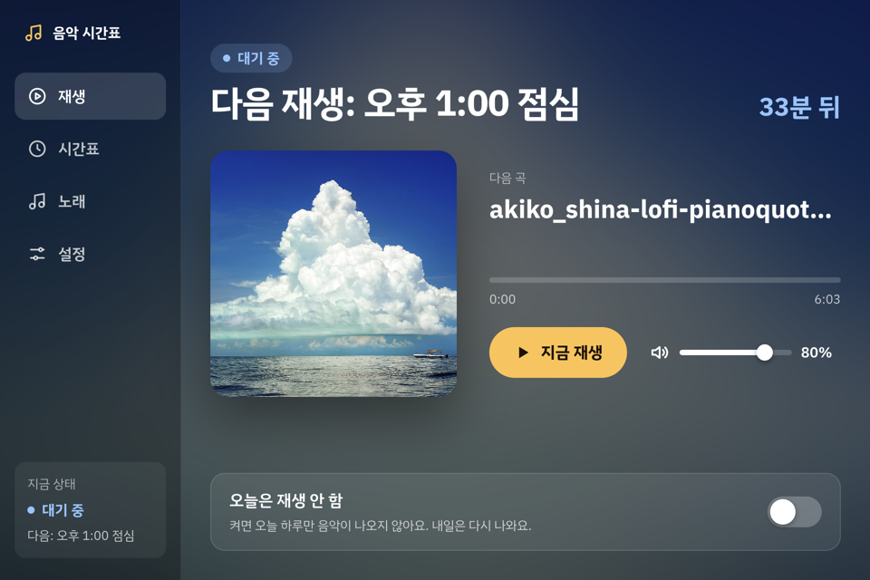
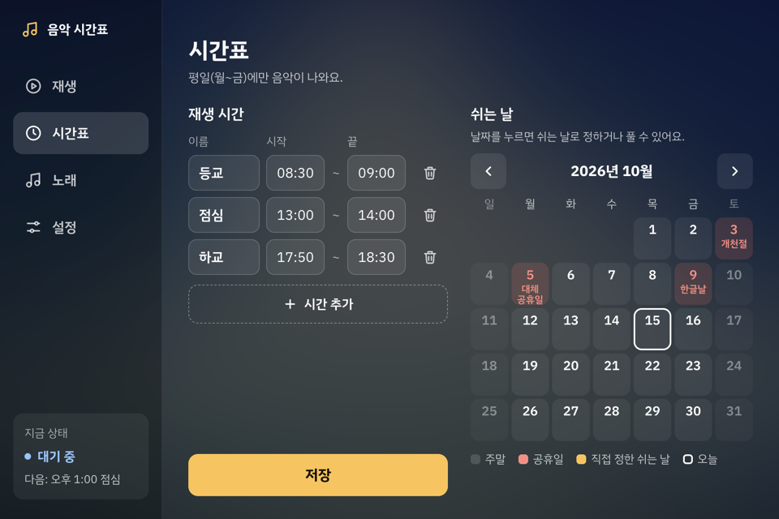
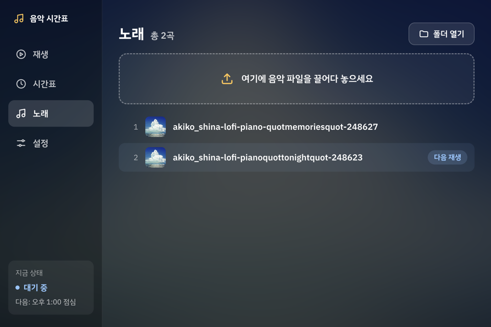
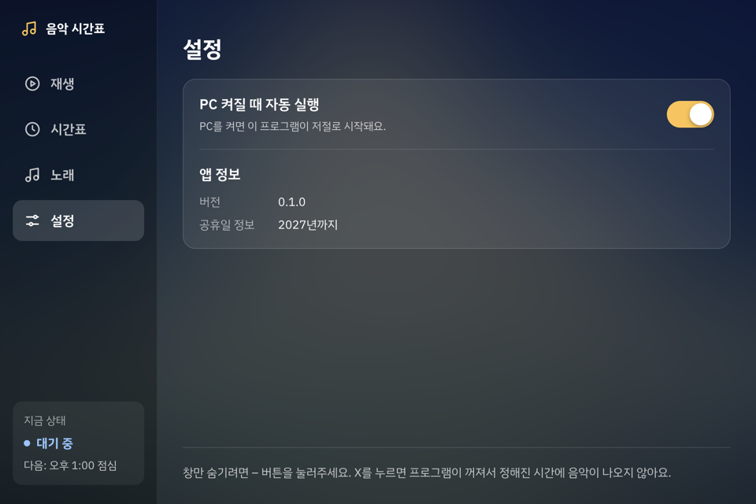

# 음악 시간표 (music-timetable)

교육장의 등교·점심·하교 시간에 맞춰 로컬 음악을 **사람 없이 자동으로 틀고 끄는** Windows 데스크톱 앱입니다.
인터넷 없이 동작하고, 비개발자도 시간표·노래·쉬는 날을 직접 관리할 수 있습니다.

| 재생                                       | 시간표                                   |
| ------------------------------------------ | ---------------------------------------- |
|  |  |
| **노래**                                   | **설정**                                 |
|         |    |

## 주요 기능

- **자동 재생·정지**
  - 기본 시간표: 등교 08:30~09:00, 점심 13:00~14:00, 하교 17:50~18:30
  - 구간이 끝나면 곡 중간이라도 바로 멈춥니다.
  - PC가 구간 도중에 켜져도 남은 시간 동안 바로 재생합니다.
- **이어서 재생**
  - 지난번 끊긴 곡의 다음 곡부터 재생합니다.
  - 순서를 바꾸거나 곡을 추가·삭제해도 이어집니다.
- **쉬는 날**
  - 주말과 내장 공휴일(2026~2027년)에는 재생하지 않습니다.
  - 달력에서 쉬는 날을 직접 정할 수 있습니다.
  - "오늘은 재생 안 함" 버튼은 오늘 하루만 끄고, 다음 날 자동으로 풀립니다.
- **노래 관리**
  - 파일을 끌어다 놓으면 음악 폴더(`내 음악/음악 시간표`)로 복사됩니다.
  - 탐색기에서 넣거나 지운 파일도 목록에 바로 반영됩니다.
  - 휴지통 버튼으로 삭제하고, 끌어서 순서를 바꿉니다.
  - 곡을 두 번 누르면 그 곡부터 재생합니다.
  - 재생 중에는 이전 곡·다음 곡으로 넘길 수 있습니다.
- **무인 운영**
  - PC 로그인 때 자동으로 최소화 상태로 실행됩니다.
  - 중복 실행을 막습니다.
  - 새벽 3시에 재시작합니다. 재생 중이거나 구간 안이면 건너뜁니다.
  - 로그 파일을 남깁니다.

## 설치 (사용자)

1. `music-timetable-<버전>-setup.exe`를 실행합니다. 설치 파일은 아래 [개발](#개발)의 `npm run build:win`으로 만듭니다.
   - 원클릭 설치이고 관리자 권한이 필요 없습니다.
2. 코드 서명이 없어서 처음 실행할 때 SmartScreen 경고가 뜰 수 있습니다. **추가 정보 → 실행**을 누르세요.
3. PC 절전 해제 같은 준비 사항은 [설치 체크리스트](docs/설치-체크리스트.md)를, 사용법은 [사용 설명서](docs/사용설명서.md)를 보세요.

> 창을 숨기려면 **–(최소화)** 를 누르세요. **X** 를 누르면 프로그램이 꺼져서 정해진 시간에 음악이 나오지 않습니다.

## 기술 스택

| 구분      | 사용                                  |
| --------- | ------------------------------------- |
| 런타임    | Electron 44                           |
| 언어      | TypeScript                            |
| 빌드      | electron-vite 5 (Vite 7)              |
| UI        | HTML/CSS/TypeScript (프레임워크 없음) |
| 태그·커버 | music-metadata                        |
| 로그      | electron-log                          |
| 테스트    | Vitest                                |
| 정적 검사 | ESLint, Prettier                      |
| 패키징    | electron-builder (Windows NSIS)       |

## 구조

```
src/
├─ main/      판단 담당: 스케줄러, 음악 폴더, 설정, 휴무일, 자동 실행·재시작, 창, IPC, media:// 프로토콜
├─ preload/   contextBridge로 window.api 하나만 노출
├─ renderer/  화면 4탭과 HTML5 Audio 재생 (문구는 messages.ts에만)
└─ shared/    공용 타입, IPC 채널 상수, 날짜·시간 순수 함수
```

- **판단은 main, 소리는 renderer**
  - main의 스케줄러가 1초마다 "지금 재생해야 하는가"를 판정합니다.
  - renderer는 재생·정지 지시만 따릅니다.
  - 판정 로직은 현재 시각을 인자로 받는 순수 함수(`*-rules.ts`)라서 Vitest로 테스트합니다.
- **보안**
  - `contextIsolation`·`sandbox`를 켜고 `nodeIntegration`은 껐습니다.
  - CSP는 로컬 자원만 허용합니다.
  - 음악·커버 파일은 `media://` 프로토콜로 허용된 폴더 안에서만 읽습니다.
- 자세한 내용은 [아키텍처 문서](docs/03-아키텍처.md)를 보세요.

## 개발

macOS·Windows 모두에서 개발할 수 있습니다. 배포 대상은 Windows입니다.

```bash
npm install          # postinstall이 Electron 실행 파일까지 받습니다
npm run dev          # 개발 실행
npm run typecheck    # 타입 검사 (main·preload·shared / renderer)
npm run lint         # ESLint
npm run format       # Prettier
npm run test         # Vitest
npm run build:win    # Windows 설치 파일 → dist/
```

- `npm run build:win`은 맥에서도 바로 됩니다. Wine이나 Docker가 필요 없습니다.
- 설치 파일에 들어가는 파일은 `electron-builder.yml`의 `files` 화이트리스트로만 정합니다.

## 문서

| 문서                                                                                                                              | 내용                                 |
| --------------------------------------------------------------------------------------------------------------------------------- | ------------------------------------ |
| [01 요구정의서](docs/01-요구정의서.md)                                                                                            | 기능·비기능 요구사항 (FR/NFR)        |
| [02 PRD](docs/02-PRD.md)                                                                                                          | 배경, 사용 시나리오, 범위, 개발 단계 |
| [03 아키텍처](docs/03-아키텍처.md)                                                                                                | 모듈 구조, IPC, 데이터               |
| [04 화면설계서](docs/04-화면설계서.md)                                                                                            | 화면별 요소와 문구                   |
| [05 코드 컨벤션](docs/05-코드컨벤션.md)                                                                                           | 코드 규칙                            |
| [milestones](docs/milestones.md)                                                                                                  | 단계별 작업과 완료 기준              |
| [사용 설명서](docs/사용설명서.md) · [설치 체크리스트](docs/설치-체크리스트.md) · [실기 테스트 점검표](docs/실기-테스트-점검표.md) | 운영 문서                            |

## 라이선스·출처

- 글꼴: IBM Plex Sans KR (SIL OFL 1.1, `resources/licenses/IBM-Plex-Sans-KR-OFL.txt`)
- 기본 커버 이미지: `resources/cover/CREDITS.md`
