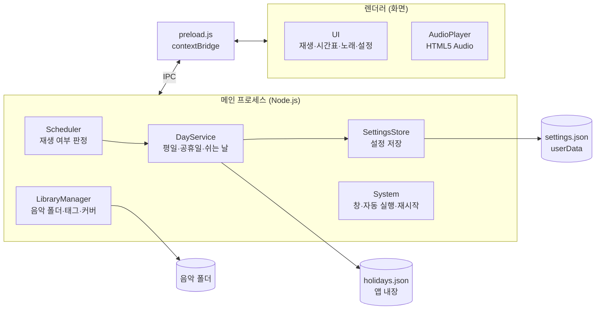

# 3. 아키텍처 설계도

## 1. 전체 구조



## 2. 프로세스별 역할

| 구성 요소 | 위치 | 역할 |
| --- | --- | --- |
| Scheduler | 메인 | 주기적으로 현재 시각을 확인해 “지금 재생해야 하는가”를 판정하고 화면에 재생/정지 명령을 보냄. 재생 순번(다음 곡 index)은 메인이 관리 |
| DayService | 메인 | 오늘이 재생하는 날인지 판단 (평일 + 내장 공휴일 아님 + 사용자 쉬는 날 아님 + “오늘은 재생 안 함” 아님) |
| LibraryManager | 메인 | 음악 폴더 읽기·감시, 드롭된 파일 복사, 태그(제목·가수·커버) 읽기 |
| SettingsStore | 메인 | settings.json 읽기·쓰기 (내보내기/가져오기는 FR-32 삭제로 없음) |
| System | 메인 | 자동 실행, 중복 실행 방지, 닫기 전 재생 위치 저장, 새벽 재시작 (트레이·종료 확인 없음) |
| preload.js | 연결부 | 화면에 필요한 기능만 노출 (contextBridge). 드롭된 파일 경로는 webUtils.getPathForFile로 얻음 (Electron 32부터 File.path 제거됨) |
| UI / AudioPlayer | 렌더러 | 화면 표시, HTML5 Audio로 실제 재생. 곡이 끝나면 메인에 알려 다음 곡을 받음 |

## 3. 스케줄러 판정 방식

“시각이 됐을 때 한 번 실행”(이벤트 방식)이 아니라 **주기적으로 현재 상태를 다시 판정**하는 방식을 사용한다. 이렇게 하면 늦게 켜진 경우(FR-06), 날짜 변경(NFR-02), PC 시계 변경을 별도 코드 없이 처리할 수 있다.

```
매 1초마다:
  재생해야함 = 오늘이_재생하는_날 AND 현재시각이_어느_구간_안에_있음
  if 재생해야함 AND 재생중아님 → 다음 곡(index)부터 재생 시작
  if 재생해야함아님 AND 재생중 → 즉시 정지, 끊긴 곡의 다음 index 저장
  화면에 상태 전달 (재생 중 구간 / 다음 재생 예정)

곡이 끝남 (구간 안):
  index + 1 (마지막이면 0) → 다음 곡 재생
```

수동 재생 버튼으로 튼 음악은 구간 밖이어도 스케줄러가 자동으로 끄지 않도록 “수동 모드” 상태를 따로 둔다. (3단계 확정)

- 구간 **밖**에서 [재생] → 수동 모드. [정지]를 누를 때까지 계속 재생한다
- 수동 재생 중 구간이 **시작**되면 끊지 않고 스케줄 재생으로 넘어가고, 그 구간이 끝나면 정지한다
- 구간 **안**에서 [재생] → 스케줄 재생과 같다 (구간 종료에 정지)
- 구간 **안**에서 [정지] → 그 구간이 끝날 때까지 다시 틀지 않는다. 다음 구간·다음 날은 정상 재생
- 수동 재생도 같은 곡 순서(nextIndex)를 쓴다
- 재생 위치 저장: 곡이 **시작될 때마다** nextIndex = 다음 곡 번호를 저장한다. 구간 종료로 끊기든 앱이 갑자기 꺼지든 다음 곡부터 이어진다. 곡을 지워 nextIndex가 곡 수를 넘으면 0번부터
- 화면이 다시 로드되면(새로고침) 화면의 소리가 끊기므로 메인도 정지 상태로 맞추고 다시 판정한다

## 4. IPC 채널 (초안)

| 채널 | 방향 | 내용 |
| --- | --- | --- |
| player:requestPlay | 화면 → 메인 | 재생 버튼(수동 재생) 요청. 무엇을 틀지는 메인이 정해 player:play로 보냄 |
| player:requestStop | 화면 → 메인 | 정지 버튼 요청. 메인이 player:stop으로 정지 지시 |
| player:play | 메인 → 화면 | 재생할 곡 정보(경로, 제목, 가수, 커버) |
| player:stop | 메인 → 화면 | 즉시 정지 |
| player:ended | 화면 → 메인 | 곡 재생 완료, 다음 곡 요청 |
| player:error | 화면 → 메인 | 재생 실패(파일 없음 등), 다음 곡으로 넘김 |
| status:update | 메인 → 화면 | 현재 상태, 다음 재생 일정, 다음 곡 |
| status:get | 화면 → 메인 | 화면을 처음 열 때 현재 상태 요청 |
| library:list / library:changed | 양방향 | 곡 목록 요청 / 폴더 변경 알림 |
| library:add | 화면 → 메인 | 드롭된 파일 경로 목록, 음악 폴더로 복사 |
| library:openFolder | 화면 → 메인 | 음악 폴더를 탐색기로 열기 (곡 삭제는 탐색기에서) |
| settings:get / settings:save | 양방향 | 설정 요청 / 시간표 저장 (메인이 다시 검사 후 시작 시각순 정렬) |
| settings:setVolume | 화면 → 메인 | 볼륨 변경 즉시 저장 (0~1) |
| settings:setAutoLaunch | 화면 → 메인 | PC 켜질 때 자동 실행 켜기/끄기 |
| day:skipToday | 화면 → 메인 | “오늘은 재생 안 함” 켜기/끄기. 켜면 오늘 날짜를 skipDate로 저장 → 날짜가 바뀌면 자동 해제 |
| day:toggleOffDay | 화면 → 메인 | 평일 하루를 쉬는 날로 지정/해제 (주말·공휴일은 메인이 거부) |
| day:holidays | 화면 → 메인 | 내장 공휴일 목록 (달력 표시용) |

## 5. 데이터 저장

| 데이터 | 위치 | 비고 |
| --- | --- | --- |
| 음악 파일 | app.getPath('music') 아래 앱 전용 폴더 (Windows에서는 사용자 “음악” 폴더) | 연구원님이 탐색기로 찾기 쉬운 위치 |
| settings.json | app.getPath('userData') | 시간표, 쉬는 날, 재생 위치, 볼륨 |
| holidays.json | 앱 내장 (`src/main/data/holidays.json`, 빌드 시 코드에 포함) | 연도별 공휴일(대체공휴일·선거일 포함). 우주항공청 월력요항 등 공식 자료로 확인 후 입력. 현재 2026~2027년 수록. 수록 연도가 끝나면 앱 업데이트 필요 (시작 시 로그 경고) |
| 기본 커버 이미지 | 앱 내장 (`resources/cover`, 배포판은 설치 폴더 `resources/cover`) | jpg·png·webp를 곡 파일 이름 해시로 고정 배정. 이미지가 없으면 단색 배경. 출처·라이선스는 같은 폴더 `CREDITS.md` |

settings.json 구조 (초안):

```json
{
  "version": 1,
  "schedule": [
    { "name": "등교", "start": "08:30", "end": "09:00" },
    { "name": "점심", "start": "13:00", "end": "14:00" },
    { "name": "하교", "start": "17:50", "end": "18:30" }
  ],
  "offDays": ["2026-12-24"],
  "skipDate": null,
  "nextIndex": 0,
  "volume": 0.8,
  "autoLaunch": true
}
```

## 6. 주요 구현 사항 (Electron API)

- 자동 재생 차단 해제: BrowserWindow webPreferences의 autoplayPolicy: 'no-user-gesture-required'
- 창 숨기기: 트레이 없이 최소화(–)로 숨긴다. 재생 판단은 메인 프로세스가 하므로 최소화로 화면 쪽 타이머가 느려져도 재생 시점은 밀리지 않는다
- 프로그램 종료: 닫기(X)를 누르면 바로 종료. 재생 위치는 곡이 시작될 때 이미 저장되므로, before-quit에서는 스케줄러·폴더 감시를 멈추고 쓰는 중인 설정 저장이 끝날 때까지 기다린 뒤 종료한다. 확인 창 없음. 마지막 창이 닫히면 앱 종료(window-all-closed → app.quit())
- 자동 실행: app.setLoginItemSettings({ openAtLogin, args: ['--autostart'] }). 배포판에서만 등록(개발 실행은 로그만). --autostart로 켜지면 창을 최소화로 시작해 화면을 가리지 않는다
- 중복 실행 방지: app.requestSingleInstanceLock(). 자동 실행된 상태에서 연구원님이 아이콘을 또 눌러도 음악이 두 번 나오지 않게 하고, 기존 창을 연다
- 새벽 재시작: 03:00~04:00 사이, 오늘 03:00 전에 시작된 앱이고(재시작 직후 반복 방지), 재생 중이 아니며 재생 구간 밖일 때 app.relaunch() 후 app.exit(). 그 1시간 동안 계속 재생 중이면 그날은 건너뛴다. 다시 켤 때 --autostart를 붙여 최소화로 시작
- 로그: electron-log, userData 쪽 logs/main.log (Windows %APPDATA%\\music-timetable\\logs, macOS ~/Library/Logs/music-timetable). 1MB 넘으면 교체. 시작·종료·재생 시작/정지(이유)·휴무일 건너뜀·오류
- 최소화 상태: backgroundThrottling: false로 화면 쪽 타이머·오디오 이벤트가 느려지지 않게 한다. 화면 프로세스가 죽으면 다시 로드하고 스케줄러가 재판정
- 폴더 감시: [fs.watch](http://fs.watch) 또는 chokidar
- 태그·커버: music-metadata 라이브러리 (메인 프로세스에서 읽어 화면에 전달)
- Windows 창 상단 바: titleBarStyle: 'hidden' + titleBarOverlay (배경을 위까지 채우면서 최소화/닫기 버튼 유지)
- 지원 파일 형식: mp3, wav, ogg, m4a (Windows 실기에서 최종 확인)

## 7. 폴더 구조 (초안)

```
bell-music/
├─ package.json
├─ main/
│  ├─ main.js            앱 시작, 창·트레이
│  ├─ scheduler.js       재생 판정
│  ├─ day-service.js     평일·공휴일·쉬는 날
│  ├─ library.js         음악 폴더·태그
│  └─ settings.js        설정 저장
├─ preload/
│  └─ preload.js
├─ renderer/
│  ├─ index.html
│  ├─ style.css
│  └─ app.js             화면·재생
└─ assets/
   ├─ holidays.json
   ├─ covers/            기본 커버 이미지
   └─ icon.ico
```

## 8. 빌드 · 배포

- 개발은 macOS에서 진행, 배포 대상은 Windows (electron-builder로 설치 파일 생성)
- macOS에서 Windows용 빌드 시 일부 과정에 Wine이 필요할 수 있음. 문제가 있으면 GitHub Actions의 Windows 환경에서 빌드
- 코드 서명 없음 → 최초 설치 시 SmartScreen 경고 (“추가 정보 → 실행”) 안내를 설치 체크리스트에 포함
- 최종 테스트는 실제 Windows PC에서 수행 (재부팅 후 자동 실행 확인 포함)

## 9. 확장 계획 (2차 버전): 공휴일 API

- 1차(MVP)부터 DayService는 holidays.json을 직접 읽지 않고 **공휴일 공급자(HolidayProvider) 함수**를 통해 목록을 받는다. 1차 구현은 앱 내장 JSON을 반환한다.
- 2차에서 공급자 내부만 바꿔 공공데이터포털 한국천문연구원 특일 정보 API를 호출한다. 스케줄러·화면·설정 구조는 변경 없음.
- 호출 시점: 미리 1년치를 받아두고, 정해진 업데이트 일정(또는 설정 화면의 "공휴일 새로 받기")에 다시 받는다. 받은 목록은 userData에 캐시하여 인터넷이 끊겨도 마지막 목록으로 동작한다.
- 필요 사항: 공공데이터포털 서비스 키 발급, 교육장 PC 인터넷 연결 여부 확인. 임시공휴일의 API 반영 시점은 실제 확인 필요.
- API 도입 후에도 "달력에서 쉬는 날 지정"과 "오늘은 재생 안 함"은 유지한다.